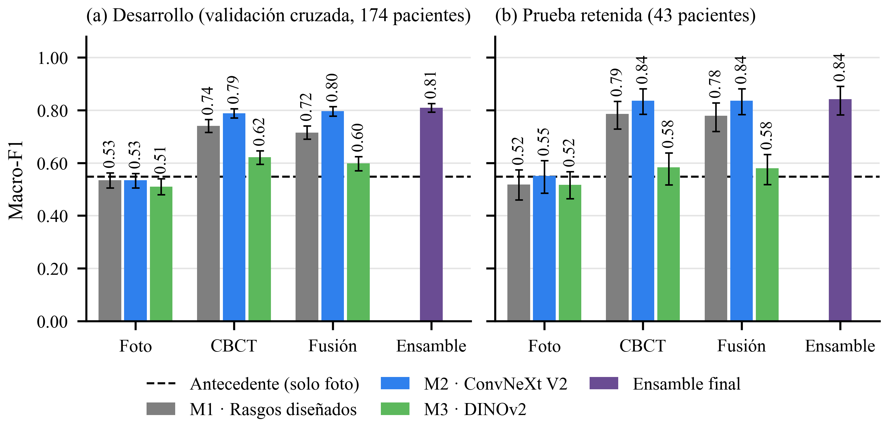
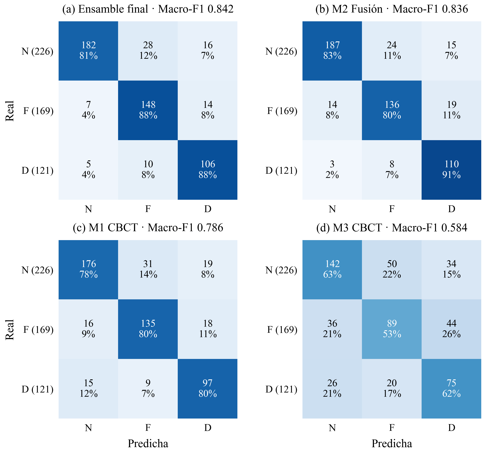
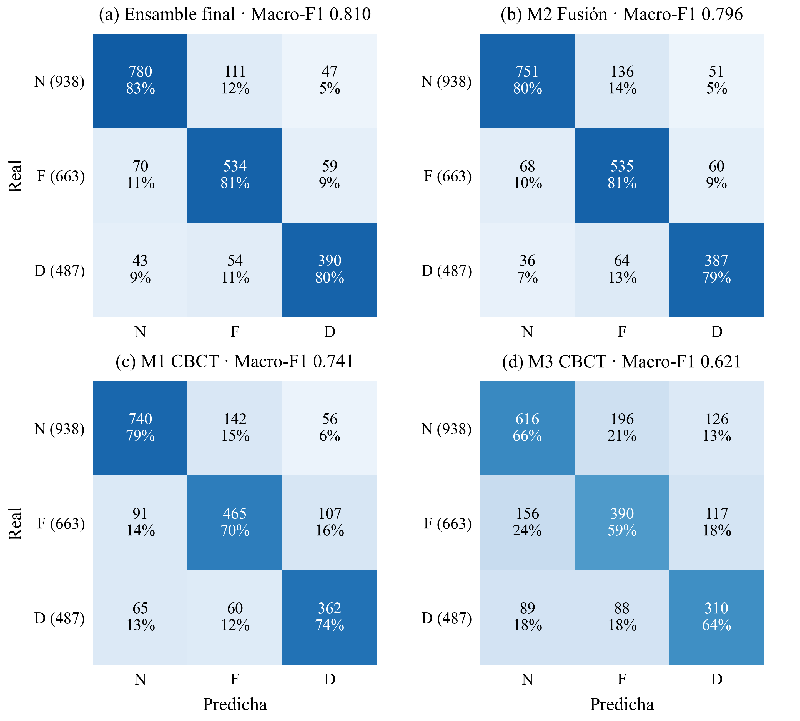
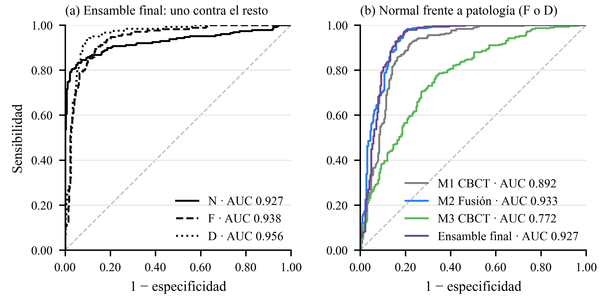
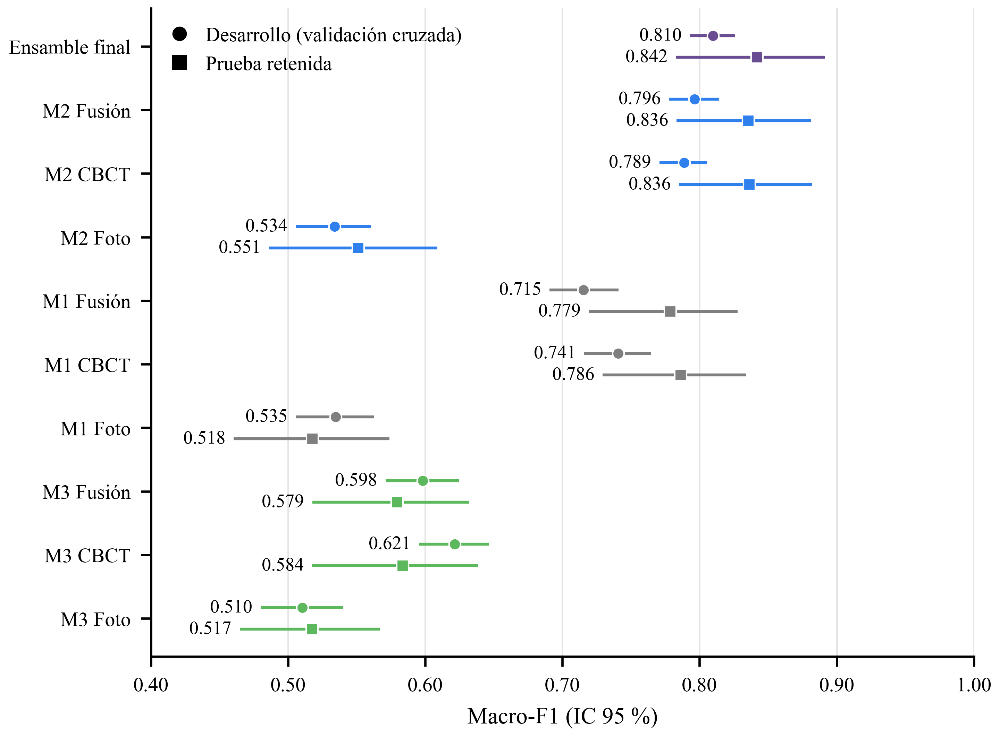
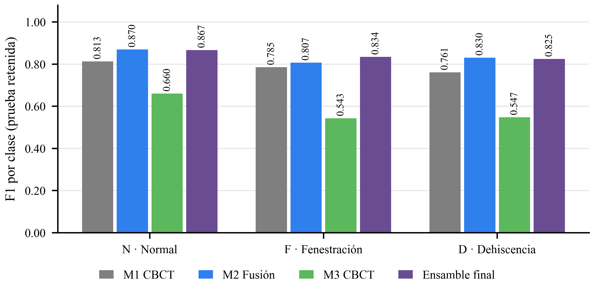
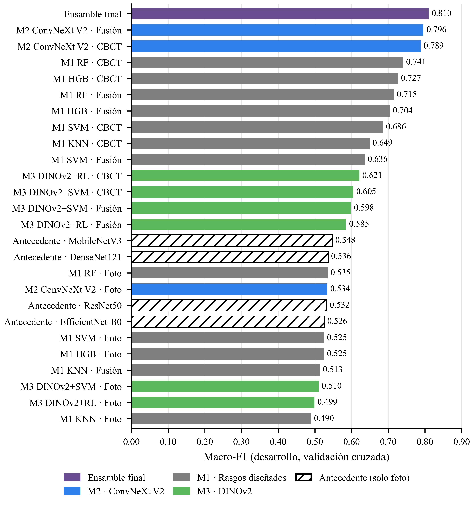

# Resultados

Clasificación de 3 clases por diente (N normal, F fenestración, D dehiscencia) en los 12 dientes anteriores,
dataset FDTooth. Todas las cifras se generan con `auditoria/figuras_tesis.py` a partir de las predicciones guardadas.

## Protocolo experimental

- Cohorte: 241 pacientes; 217 elegibles (24 excluidos por anotaciones inconsistentes) = 2604 dientes.
- **Desarrollo:** 174 pacientes / 2088 dientes (N 938 · F 663 · D 487). Validación cruzada anidada de 5 folds
  agrupada por paciente (búsqueda de hiperparámetros interna en cada fold); predicciones fuera de fold (OOF).
  Sirve para comparar y **elegir** modelos.
- **Prueba retenida:** 43 pacientes / 516 dientes (N 226 · F 169 · D 121), nunca usados para entrenar ni elegir.
  Cada modelo elegido se reentrenó con los 174 pacientes de desarrollo y se evaluó **una sola vez**.
- Métrica principal: macro-F1. También: F1 ponderado, exactitud, AUC uno-vs-resto macro, F1 y recall por clase.
- IC 95 %: bootstrap por paciente (2000 remuestreos; se remuestrean pacientes, no dientes).
- Modalidades: **Foto** (recorte intraoral del diente), **CBCT** (ROI 3D del diente), **Fusión** (ambas).
- En negrita: el mejor modelo de cada metodología (el que pasa a la comparación final).

## 0. Antecedente: solo fotografías intraorales (trabajo previo)

Mismo conjunto de desarrollo y mismos folds. Mejores configuraciones:

| Modelo | Macro-F1 | Exactitud | AUC |
|---|---|---|---|
| M2 · MobileNetV3-Small (ajuste fino) | 0.548 | 0.555 | 0.725 |
| M2 · DenseNet121 (ajuste fino) | 0.536 | 0.543 | 0.713 |
| M2 · ResNet50 (ajuste fino) | 0.532 | 0.537 | 0.706 |
| M2 · EfficientNet-B0 (ajuste fino) | 0.526 | 0.529 | 0.706 |
| M1 · HOG + SVM | 0.520 | 0.543 | 0.719 |
| M1 · HOG + Random Forest | 0.476 | 0.505 | 0.703 |

## 1. Metodología 1 · Rasgos diseñados + aprendizaje automático

Foto: HOG + LBP + color LAB. CBCT: perfil de grosor del hueso vestibular a lo largo de la raíz (umbrales 400/700/1000 HU) + longitud y volumen del diente. Clasificadores: SVM, Random Forest, HistGradientBoosting y KNN.

### Desarrollo: todos los experimentos (12 modelos)

| Modelo · modalidad | Macro-F1 [IC 95 %] | F1 pond. | Exactitud | AUC | F1 N | F1 F | F1 D | Recall N | Recall F | Recall D |
|---|---|---|---|---|---|---|---|---|---|---|
| Random Forest · CBCT | **0.741 [0.716, 0.765]** | 0.751 | 0.750 | 0.889 | 0.807 | 0.699 | 0.715 | 0.789 | 0.701 | 0.743 |
| HistGradientBoosting · CBCT | 0.727 [0.703, 0.749] | 0.739 | 0.739 | 0.883 | 0.804 | 0.675 | 0.701 | 0.788 | 0.655 | 0.758 |
| Random Forest · Fusión | 0.715 [0.691, 0.741] | 0.729 | 0.728 | 0.878 | 0.789 | 0.684 | 0.673 | 0.788 | 0.685 | 0.674 |
| HistGradientBoosting · Fusión | 0.704 [0.679, 0.729] | 0.719 | 0.718 | 0.870 | 0.790 | 0.655 | 0.668 | 0.784 | 0.638 | 0.702 |
| SVM · CBCT | 0.686 [0.659, 0.709] | 0.702 | 0.702 | 0.872 | 0.779 | 0.635 | 0.642 | 0.784 | 0.609 | 0.671 |
| KNN · CBCT | 0.649 [0.625, 0.673] | 0.669 | 0.669 | 0.832 | 0.754 | 0.615 | 0.578 | 0.757 | 0.614 | 0.575 |
| SVM · Fusión | 0.636 [0.608, 0.661] | 0.656 | 0.657 | 0.829 | 0.743 | 0.596 | 0.568 | 0.754 | 0.593 | 0.556 |
| Random Forest · Foto | 0.535 [0.506, 0.562] | 0.544 | 0.541 | 0.723 | 0.599 | 0.479 | 0.526 | 0.558 | 0.492 | 0.577 |
| SVM · Foto | 0.525 [0.497, 0.551] | 0.542 | 0.544 | 0.729 | 0.627 | 0.470 | 0.477 | 0.644 | 0.466 | 0.458 |
| HistGradientBoosting · Foto | 0.525 [0.498, 0.552] | 0.538 | 0.536 | 0.711 | 0.600 | 0.485 | 0.489 | 0.580 | 0.496 | 0.505 |
| KNN · Fusión | 0.513 [0.489, 0.538] | 0.538 | 0.546 | 0.724 | 0.659 | 0.435 | 0.446 | 0.713 | 0.398 | 0.427 |
| KNN · Foto | 0.490 [0.467, 0.512] | 0.513 | 0.526 | 0.703 | 0.630 | 0.407 | 0.432 | 0.715 | 0.342 | 0.413 |

### Prueba retenida: modelos elegidos en desarrollo

| Modelo · modalidad | Macro-F1 [IC 95 %] | F1 pond. | Exactitud | AUC | F1 N | F1 F | F1 D | Recall N | Recall F | Recall D |
|---|---|---|---|---|---|---|---|---|---|---|
| Random Forest · CBCT | **0.786 [0.729, 0.834]** | 0.792 | 0.791 | 0.911 | 0.813 | 0.785 | 0.761 | 0.779 | 0.799 | 0.802 |
| Random Forest · Fusión | 0.779 [0.719, 0.828] | 0.782 | 0.781 | 0.908 | 0.800 | 0.766 | 0.770 | 0.752 | 0.775 | 0.843 |
| Random Forest · Foto | 0.518 [0.460, 0.574] | 0.527 | 0.525 | 0.726 | 0.582 | 0.475 | 0.496 | 0.558 | 0.485 | 0.521 |

Hiperparámetros finales (Random Forest, 500 árboles): foto `max_features=0.2, min_samples_leaf=8`; CBCT `max_features=0.2, min_samples_leaf=1`; fusión `max_features=0.2, min_samples_leaf=3`.

**Matriz de confusión del mejor modelo (Random Forest · CBCT), prueba retenida**

| Real \ Predicha | N | F | D |
|---|---|---|---|
| N (226) | 176 | 31 | 19 |
| F (169) | 16 | 135 | 18 |
| D (121) | 15 | 9 | 97 |

## 2. Metodología 2 · Ajuste fino de una CNN moderna (ConvNeXt V2 Tiny)

ConvNeXt V2 Tiny preentrenada (ImageNet-22k) ajustada de extremo a extremo. CBCT: cortes 2.5D de la ROI del diente; fusión: dos ramas (foto + CBCT) con cabeza común. Pérdida con pesos por clase, aumento de datos y TTA.

### Desarrollo: todos los experimentos (3 modelos)

| Modelo · modalidad | Macro-F1 [IC 95 %] | F1 pond. | Exactitud | AUC | F1 N | F1 F | F1 D | Recall N | Recall F | Recall D |
|---|---|---|---|---|---|---|---|---|---|---|
| ConvNeXt V2 Tiny · Fusión | **0.796 [0.778, 0.814]** | 0.803 | 0.801 | 0.921 | 0.838 | 0.765 | 0.786 | 0.801 | 0.807 | 0.795 |
| ConvNeXt V2 Tiny · CBCT | 0.789 [0.771, 0.806] | 0.795 | 0.795 | 0.909 | 0.832 | 0.758 | 0.776 | 0.820 | 0.769 | 0.782 |
| ConvNeXt V2 Tiny · Foto | 0.534 [0.506, 0.560] | 0.542 | 0.540 | 0.724 | 0.590 | 0.490 | 0.523 | 0.543 | 0.498 | 0.591 |

### Prueba retenida: modelos elegidos en desarrollo

| Modelo · modalidad | Macro-F1 [IC 95 %] | F1 pond. | Exactitud | AUC | F1 N | F1 F | F1 D | Recall N | Recall F | Recall D |
|---|---|---|---|---|---|---|---|---|---|---|
| ConvNeXt V2 Tiny · CBCT | 0.836 [0.785, 0.882] | 0.839 | 0.837 | 0.931 | 0.859 | 0.812 | 0.838 | 0.783 | 0.882 | 0.876 |
| ConvNeXt V2 Tiny · Fusión | **0.836 [0.783, 0.881]** | 0.840 | 0.839 | 0.941 | 0.870 | 0.807 | 0.830 | 0.827 | 0.805 | 0.909 |
| ConvNeXt V2 Tiny · Foto | 0.551 [0.486, 0.609] | 0.543 | 0.550 | 0.747 | 0.507 | 0.562 | 0.584 | 0.376 | 0.692 | 0.678 |

Configuración final (elegida en desarrollo): fusión lr 1e-3 · 7 épocas; CBCT lr 1e-3 · 16 épocas; foto lr 3e-4 · 4 épocas (backbone lr/10). Prueba = promedio de 3 semillas.

| Modalidad | Semilla 0 | Semilla 1 | Semilla 2 | Promedio de 3 semillas |
|---|---|---|---|---|
| Fusión | 0.818 | 0.819 | 0.786 | 0.836 |
| CBCT | 0.809 | 0.805 | 0.826 | 0.836 |
| Foto | 0.493 | 0.550 | 0.576 | 0.551 |

**Matriz de confusión del mejor modelo (ConvNeXt V2 Tiny · Fusión), prueba retenida**

| Real \ Predicha | N | F | D |
|---|---|---|---|
| N (226) | 187 | 24 | 15 |
| F (169) | 14 | 136 | 19 |
| D (121) | 3 | 8 | 110 |

## 3. Metodología 3 · Modelo fundacional congelado (DINOv2) + clasificador

DINOv2 ViT-B/14 sin reentrenar como extractor de características (foto y cortes de CBCT), PCA y clasificador (regresión logística o SVM).

### Desarrollo: todos los experimentos (6 modelos)

| Modelo · modalidad | Macro-F1 [IC 95 %] | F1 pond. | Exactitud | AUC | F1 N | F1 F | F1 D | Recall N | Recall F | Recall D |
|---|---|---|---|---|---|---|---|---|---|---|
| DINOv2 + Reg. logística · CBCT | **0.621 [0.596, 0.646]** | 0.632 | 0.630 | 0.804 | 0.685 | 0.583 | 0.596 | 0.657 | 0.588 | 0.637 |
| DINOv2 + SVM · CBCT | 0.605 [0.576, 0.631] | 0.619 | 0.620 | 0.794 | 0.686 | 0.566 | 0.562 | 0.695 | 0.566 | 0.548 |
| DINOv2 + SVM · Fusión | 0.598 [0.571, 0.625] | 0.612 | 0.613 | 0.797 | 0.675 | 0.563 | 0.557 | 0.684 | 0.552 | 0.556 |
| DINOv2 + Reg. logística · Fusión | 0.585 [0.559, 0.610] | 0.598 | 0.596 | 0.782 | 0.663 | 0.535 | 0.558 | 0.635 | 0.537 | 0.600 |
| DINOv2 + SVM · Foto | 0.510 [0.480, 0.540] | 0.528 | 0.532 | 0.718 | 0.622 | 0.432 | 0.477 | 0.651 | 0.412 | 0.464 |
| DINOv2 + Reg. logística · Foto | 0.499 [0.473, 0.525] | 0.507 | 0.504 | 0.693 | 0.549 | 0.463 | 0.485 | 0.497 | 0.478 | 0.552 |

### Prueba retenida: modelos elegidos en desarrollo

| Modelo · modalidad | Macro-F1 [IC 95 %] | F1 pond. | Exactitud | AUC | F1 N | F1 F | F1 D | Recall N | Recall F | Recall D |
|---|---|---|---|---|---|---|---|---|---|---|
| DINOv2 + Reg. logística · CBCT | **0.584 [0.518, 0.639]** | 0.595 | 0.593 | 0.781 | 0.660 | 0.543 | 0.547 | 0.628 | 0.527 | 0.620 |
| DINOv2 + SVM · Fusión | 0.579 [0.518, 0.632] | 0.598 | 0.599 | 0.798 | 0.671 | 0.582 | 0.486 | 0.681 | 0.568 | 0.488 |
| DINOv2 + SVM · Foto | 0.517 [0.465, 0.567] | 0.535 | 0.541 | 0.715 | 0.634 | 0.447 | 0.471 | 0.681 | 0.402 | 0.471 |

Hiperparámetros finales: foto SVM C=1; CBCT reg. logística C=0.01; fusión SVM C=1.

**Matriz de confusión del mejor modelo (DINOv2 + Reg. logística · CBCT), prueba retenida**

| Real \ Predicha | N | F | D |
|---|---|---|---|
| N (226) | 142 | 50 | 34 |
| F (169) | 36 | 89 | 44 |
| D (121) | 26 | 20 | 75 |

## 4. Ensambles (combinación de metodologías)

Evaluados en desarrollo con los mismos folds; el ensamble final se eligió aquí, antes de ver la prueba.

| Variante · modelos combinados | Macro-F1 [IC 95 %] | Exactitud | AUC |
|---|---|---|---|
| Ensamble final (M2 fusión + M2 CBCT + M1 CBCT) | 0.810 [0.793, 0.826] | 0.816 | 0.933 |
| Stacking + umbral · M2 fusión + M2 CBCT + M1 CBCT + M1 fusión + M3 CBCT | 0.807 [0.789, 0.824] | 0.815 | 0.929 |
| Stacking (reg. logística) · M2 fusión + M2 CBCT + M1 CBCT + M1 fusión + M3 CBCT | 0.807 [0.789, 0.823] | 0.815 | 0.929 |
| Stacking + contexto del paciente · M2 fusión + M2 CBCT + M1 CBCT + M1 fusión + M3 CBCT | 0.803 [0.784, 0.821] | 0.812 | 0.931 |
| Stacking (reg. logística) · M2 fusión + M2 CBCT + M1 CBCT | 0.802 [0.785, 0.819] | 0.811 | 0.928 |
| Promedio de probabilidades · M2 fusión + M2 CBCT | 0.802 [0.784, 0.819] | 0.807 | 0.925 |
| Promedio de probabilidades · M2 fusión + M2 CBCT + M1 CBCT + M1 fusión + M3 CBCT | 0.801 [0.782, 0.818] | 0.808 | 0.930 |
| Stacking + contexto + umbral · M2 fusión + M2 CBCT + M1 CBCT | 0.799 [0.780, 0.816] | 0.807 | 0.928 |
| Stacking + contexto + umbral · M2 fusión + M2 CBCT + M1 CBCT + M1 fusión + M3 CBCT | 0.797 [0.778, 0.815] | 0.804 | 0.931 |
| Stacking + umbral · M2 fusión + M2 CBCT + M1 CBCT | 0.796 [0.778, 0.813] | 0.804 | 0.927 |
| Stacking + umbral · M2 fusión + M2 CBCT | 0.795 [0.777, 0.813] | 0.801 | 0.915 |
| Stacking + contexto del paciente · M2 fusión + M2 CBCT + M1 CBCT | 0.795 [0.776, 0.813] | 0.804 | 0.928 |
| Stacking (reg. logística) · M2 fusión + M2 CBCT | 0.791 [0.772, 0.808] | 0.798 | 0.917 |
| Stacking + contexto + umbral · M2 fusión + M2 CBCT | 0.786 [0.765, 0.805] | 0.792 | 0.916 |
| Stacking + contexto del paciente · M2 fusión + M2 CBCT | 0.782 [0.762, 0.800] | 0.791 | 0.919 |

El más simple (promedio de probabilidades de M2 fusión + M2 CBCT + M1 CBCT) fue el mejor: los métodos con parámetros aprendidos (stacking, contexto, umbrales) no lo superaron.

## 5. Comparación final de los mejores modelos

### Tabla resumen: macro-F1 por metodología y modalidad (prueba retenida; entre paréntesis, desarrollo)

| Modalidad | Antecedente | M1 Rasgos diseñados | M2 ConvNeXt V2 | M3 DINOv2 |
|---|---|---|---|---|
| Foto | — (0.548) | 0.518 (0.535) | 0.551 (0.534) | 0.517 (0.510) |
| CBCT | — | 0.786 (0.741) | 0.836 (0.789) | 0.584 (0.621) |
| Fusión | — | 0.779 (0.715) | 0.836 (0.796) | 0.579 (0.598) |
| **Ensamble final** |  |  | **0.842** (0.810) |  |

### Mejores modelos: métricas completas en la prueba retenida

| Modelo · modalidad | Macro-F1 [IC 95 %] | F1 pond. | Exactitud | AUC | F1 N | F1 F | F1 D | Recall N | Recall F | Recall D |
|---|---|---|---|---|---|---|---|---|---|---|
| Ensamble final (M2 fusión + M2 CBCT + M1 CBCT) | **0.842 [0.783, 0.891]** | 0.846 | 0.845 | 0.940 | 0.867 | 0.834 | 0.825 | 0.805 | 0.876 | 0.876 |
| ConvNeXt V2 Tiny · Fusión | 0.836 [0.783, 0.881] | 0.840 | 0.839 | 0.941 | 0.870 | 0.807 | 0.830 | 0.827 | 0.805 | 0.909 |
| ConvNeXt V2 Tiny · CBCT | 0.836 [0.785, 0.882] | 0.839 | 0.837 | 0.931 | 0.859 | 0.812 | 0.838 | 0.783 | 0.882 | 0.876 |
| Random Forest · CBCT | 0.786 [0.729, 0.834] | 0.792 | 0.791 | 0.911 | 0.813 | 0.785 | 0.761 | 0.779 | 0.799 | 0.802 |
| DINOv2 + Reg. logística · CBCT | 0.584 [0.518, 0.639] | 0.595 | 0.593 | 0.781 | 0.660 | 0.543 | 0.547 | 0.628 | 0.527 | 0.620 |

### Precisión por clase (prueba retenida)

| Modelo | Precisión N | Precisión F | Precisión D |
|---|---|---|---|
| Ensamble final (M2 fusión + M2 CBCT + M1 CBCT) | 0.938 | 0.796 | 0.779 |
| ConvNeXt V2 Tiny · Fusión | 0.917 | 0.810 | 0.764 |
| Random Forest · CBCT | 0.850 | 0.771 | 0.724 |
| DINOv2 + Reg. logística · CBCT | 0.696 | 0.560 | 0.490 |

### Desarrollo vs. prueba retenida (macro-F1 [IC 95 %])

| Modelo | Desarrollo (CV) | Prueba retenida |
|---|---|---|
| Ensamble final (M2 fusión + M2 CBCT + M1 CBCT) | 0.810 [0.793, 0.826] | 0.842 [0.783, 0.891] |
| ConvNeXt V2 Tiny · Fusión | 0.796 [0.778, 0.814] | 0.836 [0.783, 0.881] |
| ConvNeXt V2 Tiny · CBCT | 0.789 [0.771, 0.806] | 0.836 [0.785, 0.882] |
| Random Forest · CBCT | 0.741 [0.716, 0.765] | 0.786 [0.729, 0.834] |
| DINOv2 + Reg. logística · CBCT | 0.621 [0.596, 0.646] | 0.584 [0.518, 0.639] |
| ConvNeXt V2 Tiny · Foto | 0.534 [0.506, 0.560] | 0.551 [0.486, 0.609] |

### Comparaciones estadísticas (diferencia de macro-F1, bootstrap pareado por paciente)

| Pregunta | Diferencia | Desarrollo | Prueba retenida |
|---|---|---|---|
| ¿El ensamble mejora al mejor modelo individual? | Ensamble final − M2 Fusión | +0.014 [+0.002, +0.025] * | +0.006 [-0.014, +0.026] |
| M2 vs. M1 (ajuste fino vs. rasgos diseñados) | M2 Fusión − M1 CBCT | +0.056 [+0.031, +0.080] * | +0.049 [+0.013, +0.090] * |
| M1 vs. M3 (rasgos diseñados vs. DINOv2 congelado) | M1 CBCT − M3 CBCT | +0.119 [+0.089, +0.151] * | +0.203 [+0.145, +0.258] * |
| ¿La foto aporta sobre el CBCT? (M2) | M2 Fusión − M2 CBCT | +0.008 [-0.009, +0.024] | -0.001 [-0.022, +0.020] |
| ¿El CBCT aporta sobre la foto? (M2) | M2 CBCT − M2 Foto | +0.255 [+0.226, +0.283] * | +0.285 [+0.231, +0.345] * |

\* el IC 95 % no incluye 0 (diferencia significativa). La prueba retenida es pequeña (43 pacientes), por eso sus intervalos son más anchos.

### Análisis complementario: normal vs. patología (F o D agrupadas)

Mismas predicciones de 3 clases; un diente se considera patológico si P(F) + P(D) > 0.5.

| Modelo | Conjunto | Exactitud | Sensibilidad F/D | Especificidad | AUC |
|---|---|---|---|---|---|
| Ensamble final (M2 fusión + M2 CBCT + M1 CBCT) | Desarrollo | 0.871 | 0.925 | 0.804 | 0.937 |
| Ensamble final (M2 fusión + M2 CBCT + M1 CBCT) | Prueba | 0.886 | 0.979 | 0.765 | 0.927 |
| ConvNeXt V2 Tiny · Fusión | Desarrollo | 0.858 | 0.927 | 0.774 | 0.925 |
| ConvNeXt V2 Tiny · Fusión | Prueba | 0.897 | 0.972 | 0.801 | 0.933 |
| Random Forest · CBCT | Desarrollo | 0.814 | 0.895 | 0.715 | 0.896 |
| Random Forest · CBCT | Prueba | 0.853 | 0.931 | 0.752 | 0.892 |
| DINOv2 + Reg. logística · CBCT | Desarrollo | 0.734 | 0.825 | 0.622 | 0.802 |
| DINOv2 + Reg. logística · CBCT | Prueba | 0.713 | 0.824 | 0.571 | 0.772 |

### Matrices de confusión (prueba retenida)

**Ensamble final (M2 fusión + M2 CBCT + M1 CBCT)**

| Real \ Predicha | N | F | D |
|---|---|---|---|
| N (226) | 182 | 28 | 16 |
| F (169) | 7 | 148 | 14 |
| D (121) | 5 | 10 | 106 |

**ConvNeXt V2 Tiny · Fusión**

| Real \ Predicha | N | F | D |
|---|---|---|---|
| N (226) | 187 | 24 | 15 |
| F (169) | 14 | 136 | 19 |
| D (121) | 3 | 8 | 110 |

## 6. Figuras

Cada figura existe en PDF vectorial (para LaTeX, 12.2 cm de ancho: `\includegraphics[width=\textwidth]{...pdf}`) y en PNG a 600 dpi (para Word), en `resultados/figuras_tesis/`. El texto en cursiva es la leyenda sugerida.

### Figura 1

*Fig. 1. Macro-F1 (3 clases) por metodología y modalidad. (a) Desarrollo: validación cruzada anidada de 5 folds agrupada por paciente (174 pacientes, 2088 dientes). (b) Prueba retenida (43 pacientes, 516 dientes). Barras de error: IC 95 % por bootstrap de pacientes. Línea discontinua: mejor resultado del antecedente con solo fotografías (0.548).*

Archivos: `fig1_macro_f1_metodologias_v2.pdf` · `fig1_macro_f1_metodologias_v2.png`

### Figura 2

*Fig. 2. Matrices de confusión en la prueba retenida (516 dientes). Cada celda: número de dientes y porcentaje respecto de la clase real. (a) Ensamble final; (b) M2 ConvNeXt V2 con fusión foto + CBCT; (c) M1 Random Forest con CBCT; (d) M3 DINOv2 + regresión logística con CBCT.*

Archivos: `fig2_matrices_confusion_prueba_v2.pdf` · `fig2_matrices_confusion_prueba_v2.png`

### Figura 3

*Fig. 3. Matrices de confusión en desarrollo (validación cruzada, 2088 dientes), mismos modelos y formato que la Fig. 2.*

Archivos: `fig3_matrices_confusion_desarrollo_v2.pdf` · `fig3_matrices_confusion_desarrollo_v2.png`

### Figura 4

*Fig. 4. Curvas ROC en la prueba retenida. (a) Ensamble final, cada clase contra el resto. (b) Detección de patología (F o D frente a N) del mejor modelo de cada metodología y del ensamble final.*

Archivos: `fig4_curvas_roc_prueba_v2.pdf` · `fig4_curvas_roc_prueba_v2.png`

### Figura 5

*Fig. 5. Macro-F1 con IC 95 % en desarrollo (círculos) y en la prueba retenida (cuadrados) de los modelos llevados a la prueba. El color indica la metodología.*

Archivos: `fig5_desarrollo_vs_prueba_v2.pdf` · `fig5_desarrollo_vs_prueba_v2.png`

### Figura 6

*Fig. 6. F1 por clase (N normal, F fenestración, D dehiscencia) en la prueba retenida del mejor modelo de cada metodología y del ensamble final.*

Archivos: `fig6_f1_por_clase_prueba_v2.pdf` · `fig6_f1_por_clase_prueba_v2.png`

### Figura 7

*Fig. 7. Macro-F1 de todos los experimentos en el conjunto de desarrollo (mismos 2088 dientes y folds), incluidos los modelos del antecedente con solo fotografías (barras rayadas).*

Archivos: `fig7_todos_los_experimentos_v2.pdf` · `fig7_todos_los_experimentos_v2.png`

## 7. Hallazgos principales

1. **El CBCT es el factor determinante.** Con solo fotografías ninguna metodología supera ≈0.55 de macro-F1
   (igual que el antecedente); con CBCT se alcanzan 0.79–0.84 en la prueba retenida.
2. **M2 (ajuste fino) > M1 (rasgos diseñados) > M3 (DINOv2 congelado).** El orden se mantiene en desarrollo y en
   prueba. El modelo fundacional sin ajustar no se adapta bien a imágenes de CBCT.
3. **La fusión foto + CBCT aporta poco sobre CBCT solo** (diferencia no significativa en M2): el defecto óseo no
   es visible en la superficie de la encía.
4. **Modelo final** (promedio de M2 fusión + M2 CBCT + M1 CBCT): macro-F1 0.842
   [0.783, 0.891] en la prueba retenida (desarrollo 0.810),
   exactitud 0.845, AUC 0.940, con F1 equilibrado en las tres clases
   (0.87 / 0.83 / 0.82). Su ventaja sobre M2 fusión solo es significativa en
   desarrollo (+0.014); en la prueba (+0.006) no lo es: en la práctica, ambos rinden igual.
5. **Como detector de patología** el modelo final tiene sensibilidad 0.979 y especificidad
   0.765: casi no omite dientes con F o D; su error principal es marcar como patológicos
   algunos dientes normales.
6. Los valores de prueba son algo mayores que los de desarrollo, pero los intervalos se solapan: indica ausencia
   de sobreajuste en la selección de modelos, no una mejora real.
